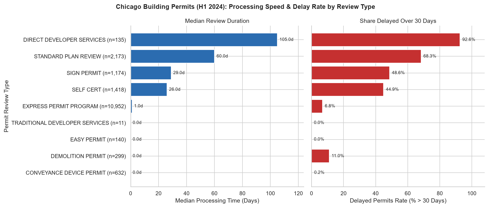
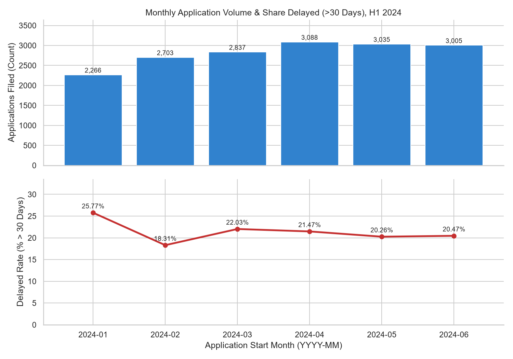
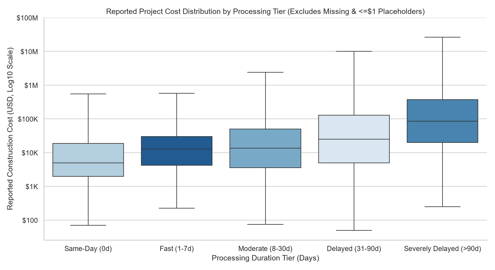
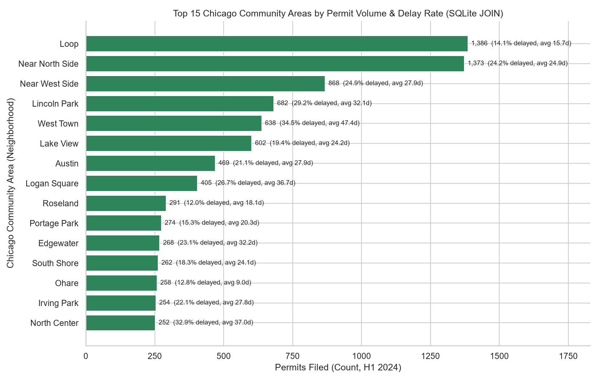
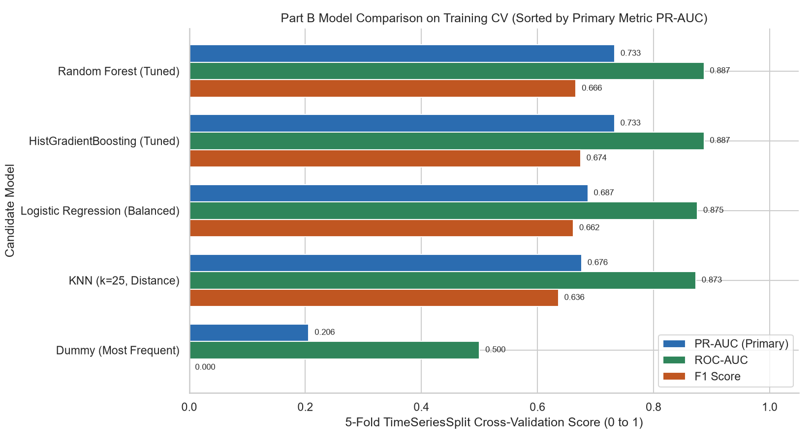
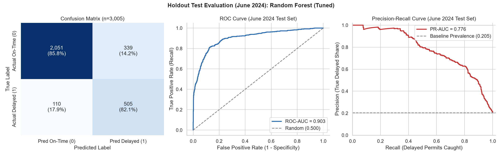
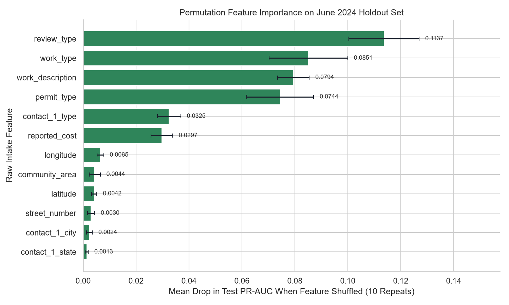
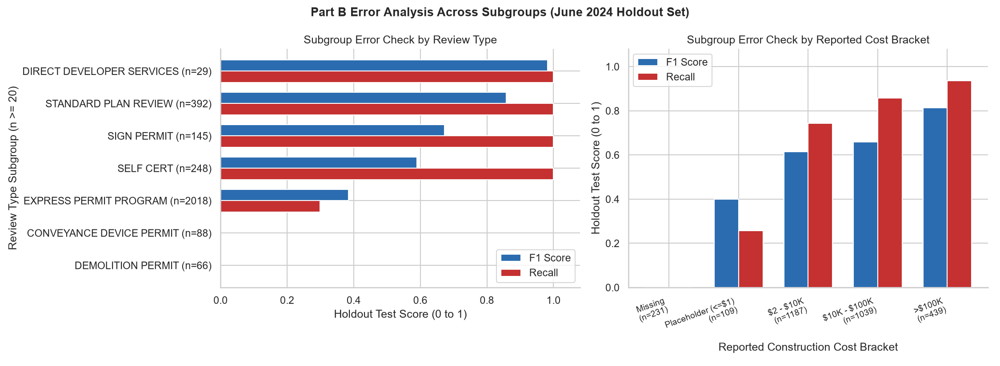

# Reproducible Data Pipelines, Tabular ML & Systems Exploration

> **Write-ups & Documentation**: [Project Write-ups & Documentation (Google Doc)](https://docs.google.com/document/d/1wccAHNu3aKxX6hXiF19ov8Lx1y56MF_EyiLIqiX162U/edit?usp=sharing)

An end-to-end reproducible data engineering and tabular machine learning project built on a real-world dataset, accompanied by systems engineering exploration artifacts.

## Overview

- **Part A — Reproducible Data Quality & Insights Pipeline (35%)**: Inspect raw data, document its schema, write testable cleaning and validation functions, compute Pandas/NumPy summaries, run SQLite queries, generate visual insights, and produce a before-and-after data-quality report.
- **Part B — End-to-End Tabular ML Baseline (40%)**: Frame a prediction task, perform a justified leakage-free train/test split, build a unified `scikit-learn` `Pipeline` + `ColumnTransformer`, compare a baseline against candidate models, run error analysis, and save the fitted pipeline for unseen inference.
- **Part C — Exploration Homework (15%)**: Explore four systems and software engineering topics in [docs/exploration.md](docs/exploration.md) alongside working artifacts: SQLite feed query optimization & recency/likes ranker ([sql/c1_feed_schema.sql](sql/c1_feed_schema.sql), [src/c1_feed_experiment.py](src/c1_feed_experiment.py)), GitHub Actions CI & PR governance ([.github/workflows/ci.yml](.github/workflows/ci.yml), [.github/pull_request_template.md](.github/pull_request_template.md), [.github/CODEOWNERS](.github/CODEOWNERS)), system design theory, and a repeatable system design workflow + 1-page Design Doc.

## Repository Structure

```text
.
├── .github/
│   ├── CODEOWNERS                # Part C2 code ownership rules
│   ├── pull_request_template.md  # Part C2 PR template & review checklist
│   └── workflows/
│       └── ci.yml                # Part C2 GitHub Actions CI (ruff + pytest)
├── data/
│   ├── raw/                      # Original raw data (never edited or overwritten)
│   ├── cleaned/                  # Reproducible Part A cleaned dataset output
│   └── sample_unseen_permits.csv # Sample unseen applications for inference CLI demo
├── docs/
│   ├── assumptions.md            # Part A cleaning assumptions & Part B Model Card
│   ├── dataset_proposal.md       # Checkpoint 0 dataset proposal
│   ├── exploration.md            # Part C1–C4 write-ups, glossary, workflow & design doc
│   └── schema.md                 # Raw & cleaned data schema documentation
├── models/                       # Saved Part B pipeline (.joblib) & model metadata JSON
├── notebooks/                    # Exploration notebooks only (results exist as files)
├── outputs/
│   ├── figures/                  # Saved Part A (01–04) & Part B (05–08) visualizations
│   └── reports/                  # Quality reports, CV table, C1 benchmark, predictions
├── sql/                          # Part A SQLite JOIN & Part C1 feed schema/queries
├── src/                          # Download, inspect, clean, validate, analyze, SQL, ML, C1
├── tests/                        # Pytest unit & integration tests (Part A + Part B + Part C)
├── README.md
└── requirements.txt              # Pinned Python dependencies
```

## Setup Instructions

**Prerequisites**: Python 3.13+ (tested on Python 3.13.15).

1. Clone the repository:
   ```bash
   git clone <REPOSITORY_URL>
   cd "<REPOSITORY_FOLDER>"
   ```

2. (Optional, recommended) Create and activate a virtual environment:
   ```bash
   python -m venv .venv
   # Windows PowerShell:
   .\.venv\Scripts\Activate.ps1
   # Linux/macOS:
   source .venv/bin/activate
   ```

3. Install pinned dependencies:
   ```bash
   pip install -r requirements.txt
   ```

## Dataset

Details and justification are documented in [docs/dataset_proposal.md](docs/dataset_proposal.md) and [docs/schema.md](docs/schema.md).

- **Dataset Name**: City of Chicago Building Permits (H1 2024 Operational Extract)
- **Source Portal**: https://data.cityofchicago.org/Buildings/Building-Permits/ydr8-5enu
- **API Endpoint**: `https://data.cityofchicago.org/resource/ydr8-5enu.csv`
- **Licence**: City of Chicago Data Terms of Use — Public Open Data (https://www.chicago.gov/city/en/narr/foia/data_disclaimer.html)
- **Access Date**: `2026-11-21`
- **Rows / Columns**: `16,934` rows × `29` columns (`7.55 MB`)
- **Prediction Target (Part B)**: `is_delayed` (`processing_time > 30` days — binary classification: `21.24%` delayed vs. `78.76%` on-time/fast)

Reproduce the raw download and read-only audit (raw files in `data/raw/` are never edited or overwritten):
```bash
python src/download_data.py
python src/inspect_raw.py
```

## Running Part A (Data Quality & Insights Pipeline)

1. *(Optional if raw files are already present)* Download raw permits & official community area lookup:
   ```bash
   python src/download_data.py
   ```
2. Run all Part A unit & SQLite integration tests:
   ```bash
   pytest -v
   ```
3. Run the reproducible Part A pipeline (cleaning, validation quality gate, Pandas/NumPy summaries, SQLite join, charts, and reports):
   ```bash
   python src/run_part_a.py
   ```
4. Demonstrate the **Bonus Quality Gate** failing loudly on a deliberately corrupted copy and passing on the real dataset:
   ```bash
   python src/run_part_a.py --demo-quality-gate
   ```

## Running Part B (Tabular ML Pipeline)

1. Run chronological splitting, 5-fold `TimeSeriesSplit` model comparison & tuning, final June 2024 holdout evaluation, permutation importance, error analysis, Part B figures, and pipeline saving (`models/best_delay_pipeline.joblib`):
   ```bash
   python src/train_part_b.py
   ```
2. Score unseen building permit applications from a fresh Python session (`predict.py` validates all 14 required intake columns and outputs predicted labels, probabilities, and risk bands):
   ```bash
   python src/predict.py data/sample_unseen_permits.csv --output outputs/reports/sample_predictions.csv
   ```
3. Run all Part A + Part B unit and integration tests:
   ```bash
   pytest -v
   ```

## Findings & Figures

### Part A: Data Quality & Validation Results

Full before-and-after metrics and tables live in [outputs/reports/data_quality_report.md](outputs/reports/data_quality_report.md) and [outputs/reports/metrics.json](outputs/reports/metrics.json).

- **Raw vs. Cleaned**: Processed **`16,934` rows** (`0` duplicates removed) from `29` raw columns to `41` cleaned/feature columns; normalized **`10,952`** Unicode en-dash values in `permit_type`, fixed **`41`** invalid `contact_1_state` entries (`'ILLINOIS'`/`'IL.'` -> `'IL'`), converted **`3`** `community_area == 0` and **`3`** `ward == 0` sentinels to `pd.NA`, filled **`10,006`** categorical nulls (`"UNSPECIFIED"`/`"UNKNOWN"`), and flagged **`543`** `reported_cost <= $1` placeholders plus **`41`** `> $10M` mega-projects (`99th` percentile cap `$3,083,746.50`) while preserving numeric nulls to prevent Part B leakage.
- **Quality Gate (Bonus Challenge)**: Enforced a `99.00%` minimum row validation pass rate (`src/validation.py`):
  - **Real Dataset**: **PASSED** with **`100.0000%`** row validation pass rate (`16,934 / 16,934` valid rows; `outputs/reports/metrics.json`).
  - **Deliberately Corrupted Copy (`--demo-quality-gate`)**: **FAILED loudly** (`ValidationError`) with **`97.0474%`** pass rate (`500` invalid rows caught across negative `processing_time`, invalid `latitude`, invalid `street_direction`, invalid `contact_1_state`, and `is_delayed` nulls; logged in `outputs/reports/metrics_corrupted_demo.json`) without writing cleaned outputs.
- **NumPy & Pandas Key Insights**: Processing time has a mean of **`27.04` days** (`std = 65.12` days), median **`4.0` days**, and p90 **`72.0` days**. Across `15,195` permits with valid reported cost `> $1.00`, `numpy.corrcoef` shows a positive correlation (`r = 0.3407`) between `log(1 + cost)` and `log(1 + processing_time)`.

### Part A Visualizations (`outputs/figures/`)

1. 
   *Shows that `EXPRESS PERMIT PROGRAM` applications clear with a median of 1 day (`6.81%` delayed), whereas `STANDARD PLAN REVIEW` (`68.29%` delayed) and `DIRECT DEVELOPER SERVICES` (`92.59%` delayed) account for the steepest review bottlenecks.*
2. 
   *Shows H1 2024 permit applications increasing from January (`2,266`) into spring (`3,005–3,088`/month in April–June) while monthly delay rates remained between `18.31%` and `25.77%`.*
3. 
   *Shows median reported construction cost rises steadily from same-day approvals (`$4,000` median) up to `Severely Delayed (>90d)` projects (`$80,000` median).*
4. 
   *Shows neighborhood-level permitting concentration from the SQLite join, led by `Loop` (`1,386`), `Near North Side` (`1,373`), and `Near West Side` (`868`), with `West Town` experiencing a `34.48%` delay rate.*

### Part A SQLite Query & Explanation ([sql/community_area_insights.sql](sql/community_area_insights.sql))

```sql
SELECT
    c.community_area,
    c.area_name,
    COUNT(*) AS permit_count,
    SUM(p.is_delayed) AS delayed_count,
    ROUND(100.0 * AVG(p.is_delayed), 2) AS delayed_rate_pct,
    ROUND(AVG(p.processing_time), 2) AS avg_processing_days,
    ROUND(SUM(COALESCE(p.reported_cost, 0.0)), 2) AS total_reported_cost_usd,
    ROUND(AVG(CASE WHEN p.reported_cost > 1.0 THEN p.reported_cost END), 2) AS avg_reported_cost_usd,
    ROUND(SUM(p.total_fee), 2) AS total_fees_usd
FROM permits AS p
INNER JOIN community_areas AS c
    ON p.community_area = c.community_area
WHERE p.community_area IS NOT NULL
GROUP BY c.community_area, c.area_name
HAVING COUNT(*) >= 100
ORDER BY permit_count DESC;
```

- **Result Explanation**: Joining the `16,934` cleaned permits against the `77` official Chicago community area names (`data/raw/chicago_community_areas.csv`) returned **`57` neighborhoods** with `>= 100` permits (`outputs/reports/sql_community_area_insights.csv`). Downtown/central neighborhoods dominate volume (`Loop`: `1,386` permits at `14.14%` delayed; `Near North Side`: `1,373` permits with `$690.0M` total reported cost), while outer/residential neighborhoods like `South Deering` (`4.76%` delayed) and `Ashburn` (`6.74%` delayed) exhibit much lower delay rates than `West Town` (`34.48%` delayed) or `Bridgeport` (`33.33%` delayed).

### Part B: Tabular ML Baseline & Evaluation

Full evaluation details, subgroup tables, and concrete misclassified examples are saved in [outputs/reports/part_b_evaluation_report.md](outputs/reports/part_b_evaluation_report.md), [models/model_metadata.json](models/model_metadata.json), and the Model Card in [docs/assumptions.md](docs/assumptions.md).

- **Problem & Leakage Control**: Predict at permit submission time whether `is_delayed = 1` (`processing_time > 30` days) using **`14` strictly pre-application intake columns** (`src/features.py`). All **`14` post-intake / target / full-dataset-derived columns** (`issue_date`, `processing_time`, `processing_tier`, `permit_status`, `permit_milestone`, all 7 fee columns, `fee_to_cost_ratio`, and `reported_cost_winsorized`) are excluded.
- **Chronological Split**: Split strictly before fitting any preprocessing (`application_start_date < 2024-06-01`): **`13,929` rows** in Jan–May 2024 (`21.41%` delayed) for 5-fold `TimeSeriesSplit` CV and tuning, and **`3,005` rows** in June 2024 (`20.47%` delayed) held out for a single final evaluation.
- **Metric Justification**: Because `~79.4%` of training applications clear within 30 days, `Dummy (Most Frequent)` reaches **`79.41%` CV accuracy** with **`0.0000` recall** and **`0.0000` F1**. Model selection therefore uses **PR-AUC (`average_precision`)** alongside ROC-AUC, F1, Precision, Recall, and the Confusion Matrix.

#### Model Comparison (5-Fold `TimeSeriesSplit` CV on Training Set, `n=13,929`)

| Model | CV PR-AUC | CV ROC-AUC | CV F1 | CV Precision | CV Recall | CV Accuracy | Tuned Hyperparameters |
| --- | ---: | ---: | ---: | ---: | ---: | ---: | --- |
| **Random Forest (Tuned)** | **0.7330 ± 0.0249** | **0.8868 ± 0.0204** | 0.6662 | 0.5546 | 0.8347 | 0.8277 | `max_depth=12, min_samples_leaf=5` |
| HistGradientBoosting (Tuned) | 0.7327 ± 0.0319 | 0.8868 ± 0.0221 | 0.6743 | 0.5695 | 0.8270 | 0.8354 | `learning_rate=0.05, max_depth=4, min_samples_leaf=20` |
| Logistic Regression (Balanced) | 0.6868 ± 0.0403 | 0.8755 ± 0.0206 | 0.6618 | 0.5458 | 0.8415 | 0.8228 | `class_weight="balanced"` |
| KNN (`k=25`, Distance) | 0.6761 ± 0.0278 | 0.8728 ± 0.0156 | 0.6360 | 0.6622 | 0.6134 | 0.8555 | `n_neighbors=25, weights="distance"` |
| Dummy (Most Frequent) | 0.2059 ± 0.0085 | 0.5000 ± 0.0000 | 0.0000 | 0.0000 | 0.0000 | 0.7941 | `strategy="most_frequent"` |

- **Final June 2024 Holdout Test (`Random Forest (Tuned)`, `n=3,005`)**: **PR-AUC = `0.7757`** (vs. `0.2047` prevalence), **ROC-AUC = `0.9026`**, **F1 = `0.6923`**, **Precision = `0.5983`**, **Recall = `0.8211`**, **Accuracy = `0.8506`** (`TN=2,051`, `FP=339`, `FN=110`, `TP=505`).
- **Feature Importance & Bonus CLI (`src/predict.py`)**: Top permutation-importance features on the holdout set are **`review_type` (`+0.1137`)**, **`work_type` (`+0.0851`)**, **`work_description` (`+0.0794`)**, **`permit_type` (`+0.0744`)**, and **`contact_1_type` (`+0.0325`)** — confirming that review workflow, scope of work, and permit category drive delay times. Scoring [data/sample_unseen_permits.csv](data/sample_unseen_permits.csv) in a fresh session predicts **`6 / 10` delayed** (`outputs/reports/sample_predictions.csv`), cleanly flagging high-cost Standard Plan Review and Direct Developer Services permits while handling missing cost/coordinates, Unicode dashes, `'ILLINOIS'`/`'IL.'`, and unseen categories (`Geothermal Retrofit`).
- **Concrete Error Patterns**:
  - *False Positives (`339`)* concentrate in `SELF CERT` (`40.32%` actual delayed vs. `96.37%` predicted, `Precision=0.4184`) and near-cutoff `STANDARD PLAN REVIEW` permits cleared in `19–30` days (e.g., IDs `3379835` at `30d`, `3382552` at `29d`, `3382837` at `27d`).
  - *False Negatives (`110`)* concentrate in `EXPRESS PERMIT PROGRAM` (`Recall=0.2986`, `F1=0.3839`), notably `Small-Scale Solar PV System` (e.g., `N2135589` at `38d`, `N2093532` at `48d`) and cost-missing `Administrative Change` permits (`N2139640` at `100d`) hit by post-submission holds.

### Part B Visualizations (`outputs/figures/`)

5. 
   *Compares 5-fold `TimeSeriesSplit` CV PR-AUC, ROC-AUC, and F1 across all 5 models, showing `Random Forest (Tuned)` and `HistGradientBoosting (Tuned)` outperforming `Logistic Regression`, `KNN`, and `Dummy`.*
6. 
   *Shows the winning `Random Forest (Tuned)` pipeline achieving `0.9026` ROC-AUC, `0.7757` PR-AUC, and `82.1%` recall (`505 / 615` delayed permits caught) on the June 2024 holdout test set.*
7. 
   *Ranks the 12 most influential raw intake columns by holdout PR-AUC drop, led by `review_type`, `work_type`, `work_description`, and `permit_type`.*
8. 
   *Breaks down F1 and Recall across `review_type` and `reported_cost` brackets, highlighting strong performance on `STANDARD PLAN REVIEW` (`F1=0.8586`) and `>$100K` projects (`F1=0.8135`) versus low recall on rare `EXPRESS` delays and missing-cost applications.*

## Part C: Systems & Engineering Exploration

Complete write-ups, guiding question answers, and cited sources are in [docs/exploration.md](docs/exploration.md).

- **C1 — SQLite Feed Query Optimization & Bonus (+2) Feed Ranker**:
  - Artifacts: [sql/c1_feed_schema.sql](sql/c1_feed_schema.sql), [src/c1_feed_experiment.py](src/c1_feed_experiment.py), [outputs/reports/c1_feed_experiment_report.md](outputs/reports/c1_feed_experiment_report.md), [outputs/reports/c1_feed_experiment_results.json](outputs/reports/c1_feed_experiment_results.json)
  - Run benchmark: `python src/c1_feed_experiment.py`
  - **Measured Result (`1,000` users, `150,000` posts, `80` followed authors)**: Adding composite index `idx_posts_author_created(author_id, created_at DESC)` replaced `SCAN p` with `SEARCH p USING INDEX`, speeding up chronological top-20 feed retrieval **`23.22×`** (`56.22 ms -> 2.42 ms`). For the **Bonus Top-10 Ranker** (`(likes + 1) / (age_hours + 2)^2` over a 7-day window), indexing improved latency **`6.40×`** (`25.47 ms -> 3.98 ms`), and an in-memory cache hit served the identical top-10 list in **`0.000123 ms`** (**`207,090.2×`** faster).
- **C2 — GitHub Actions CI, Branch Rules & PR Governance**:
  - Artifacts: [.github/workflows/ci.yml](.github/workflows/ci.yml) (triggers on PRs/pushes to `main`, caches pip dependencies, runs `ruff check src/ tests/` and `pytest -v`), [.github/pull_request_template.md](.github/pull_request_template.md) (author self-check + code review checklist), and [.github/CODEOWNERS](.github/CODEOWNERS).
- **C3 — Theory of System Design**:
  - 10-term core glossary with concrete examples (Requirements, Capacity Estimation, Load Balancing, Caching, SQL, NoSQL, Message Queue, Replication, Consistency, Availability), CAP Consistency vs. Availability trade-off paragraph, and SQL vs. Key-Value comparison in [docs/exploration.md](docs/exploration.md).
- **C4 — System Design Workflow & One-Page Design Document**:
  - 7-step repeatable design workflow applied step-by-step to design the **Chicago Permit Delay Triage & Notification Service** in [docs/exploration.md](docs/exploration.md).

## Tools & Academic Integrity Disclosure

All code, analysis, and documentation in this repository are understood and explainable line-by-line by the author. Tools used during development:
- Python 3.13 (`pandas`, `numpy`, `matplotlib`, `seaborn`, `scikit-learn`, `joblib`, `scipy`, `requests`, `openpyxl`, `sqlite3`, `pytest`, `ruff`)
- AI coding assistant (used as a learning and scaffolding aid; all decisions verified and explainable by the author)
